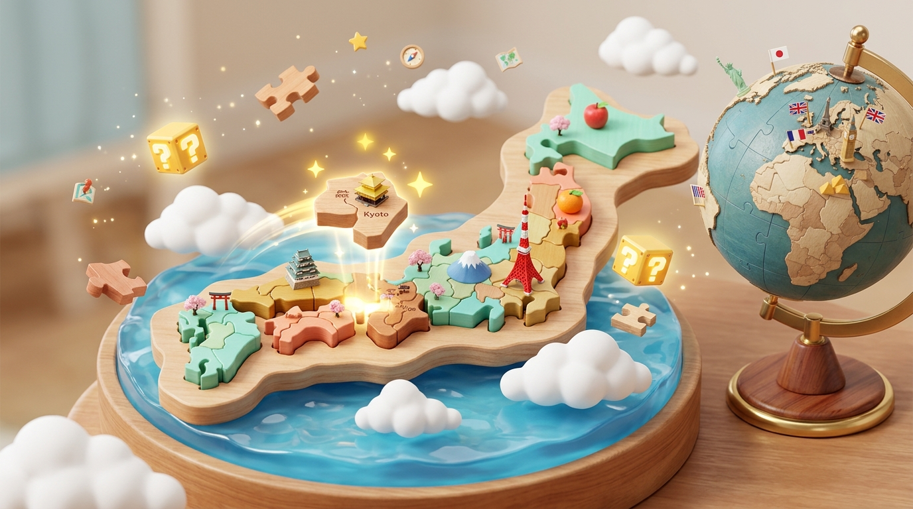

# 🗺️ 地図クラフト - リアル日本地図立体パズル ＆ 3D地球儀

Three.js × リアル地理データで実現した、市販の知育玩具を超える本格3D地図学習パズルゲーム！

🌐 **公開URL (GitHub Pages):**  
👉 **[https://hisanoripyon1226-basketball-alt.github.io/eight-app-2/](https://hisanoripyon1226-basketball-alt.github.io/eight-app-2/)**

---

## 🌟 主な特徴・ゲームシステム

### 1. 🧩 都道府県＆世界の国の「リアルな形」を極限追求
- 国土地理院・国際オープン地理データ（TopoJSON）をもとに、**47都道府県および世界各国の実物通りの精緻な輪郭線**から立体木製パズル風メッシュを生成！
- 下北・津軽半島のくびれ、房総半島、能登半島、イタリアのブーツ型、チリの細長い形状など、本物のリアルなシルエットをパズルのように直接触れて学べます。

### 2. 🖱️ 直感的な「3Dドラッグ＆ドロップ」操作
- トレイからピースをマウスまたはタッチでドラッグ！
- 正しいスロットに近づけると、磁石のように**「カチッ！」とマグネット吸着（スナップ）**してフィット！
- 間違った場所に落とすと「ポヨン」と震えて元のトレイへスムーズに戻ります。
- 画面上部の「📐 トレイ: 下部 ⇔ 左横」ボタンで、ドラッグしやすい位置へ自由に切り替え可能。

### 3. 🎯 「はてなブロックは純粋なヒント」
- 白地図上の「？」ピンをクリックしても、**都道府県名や国名などの答えは絶対に表示されません！**
  - 🏛️ **県庁所在地 / 首都**
  - 🍎 **代表的な特産品・名物**
  - 🏯 **有名な名所・世界遺産**
  - 🧩 **形状の特徴（シルエットのヒント）**
  - 💡 **豆知識・クイズヒント**
- ヒントから推理して、手持ちピースの中から「これだ！」と思う形のピースを探してドラッグする、脳をフル回転させる学習スタイルです。

### 4. 🌍 本物の傾きを持つ「回転リアル3D地球儀」
- 世界地図モードは、23.4度自転軸が傾いた真鍮スタンド付きの本格3D地球儀！
- マウスドラッグで地球儀をクルクルと360度自由に回転させながら、世界各国のピースを正しい位置へドラッグ＆ドロップ！

### 5. 🔍 形状ズームビューア（暗記用クローズアップ）
- ピースを掴んだ瞬間、画面上部に**リアルな拡大シルエット**がダイナミックに浮遊表示！
- 形の特徴（「カニのような形」「人の横顔」「ブーツの形」など）がハイライトされ、形そのものを強烈に脳に焼き付けます。

### 6. ⚡ 4大特訓クイズ道場（日本の形・世界の形・国旗・首都）
- 🗾 **日本の形シルエットクイズ** (全47都道府県)
- 🌍 **世界の国の形シルエットクイズ** (世界数十カ国のリアルシルエット)
- 🚩 **世界の国旗クイズ** (特大国旗アイコン＋首都ヒント)
- 🏛️ **世界の首都当てクイズ**

### 7. 🗣️ Web Speech API によるネイティブ音声読み上げ
- パズルがカチッとはまった瞬間に、**「正解！青森県！県庁所在地は青森市！」**と日本語音声で自動読み上げ。
- 目（視覚）＋手（触覚）＋耳（聴覚）のトリプル刺激で、抜群の記憶定着率を誇ります。

---

## 🎮 操作方法
- **ピースのドラッグ:** マウス左ボタンドラッグ / 指でスワイプしてスロットへ運ぶ
- **地図・地球儀の回転:** 背景をマウス左ドラッグ / スワイプ
- **地図の移動（パン）:** マウス右ドラッグ / 2本指スワイプ
- **ズームイン・アウト:** マウスホイール / ピンチイン・アウト
- **トレイ位置切り替え:** 画面上の「📐 トレイ: 下部 ⇔ 左横」ボタン
- **視点リセット:** 画面右上の「🎥 視点リセット」ボタン

---

## 🛠️ 技術スタック
- **3Dグラフィックス:** Three.js (r128), OrbitControls, ExtrudeGeometry
- **地理データ:** TopoJSON, GeoJSON (日本47都道府県 & 世界177カ国)
- **オーディオ:** Web Audio API (プロシージャル合成) & Web Speech API (音声合成)
- **デプロイ:** GitHub Actions + GitHub Pages (完全自動公開)
